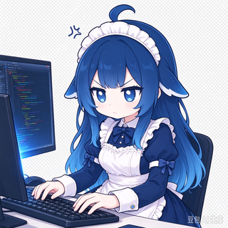
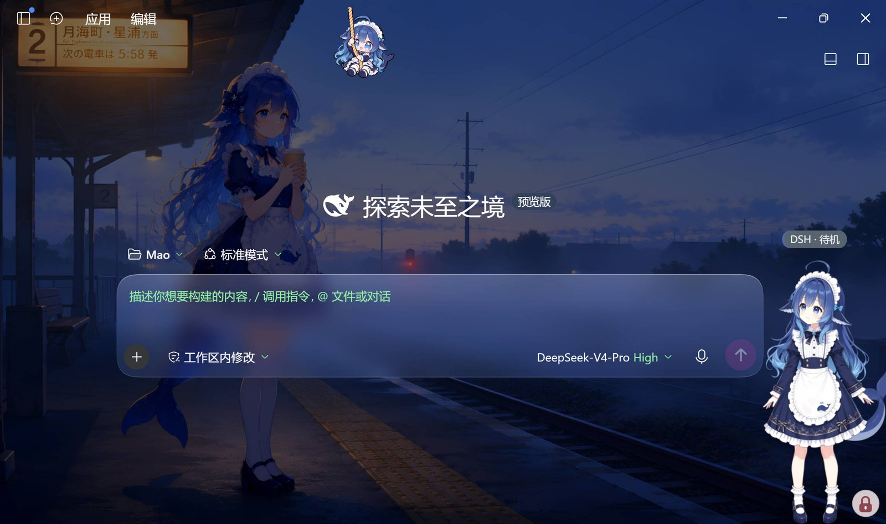
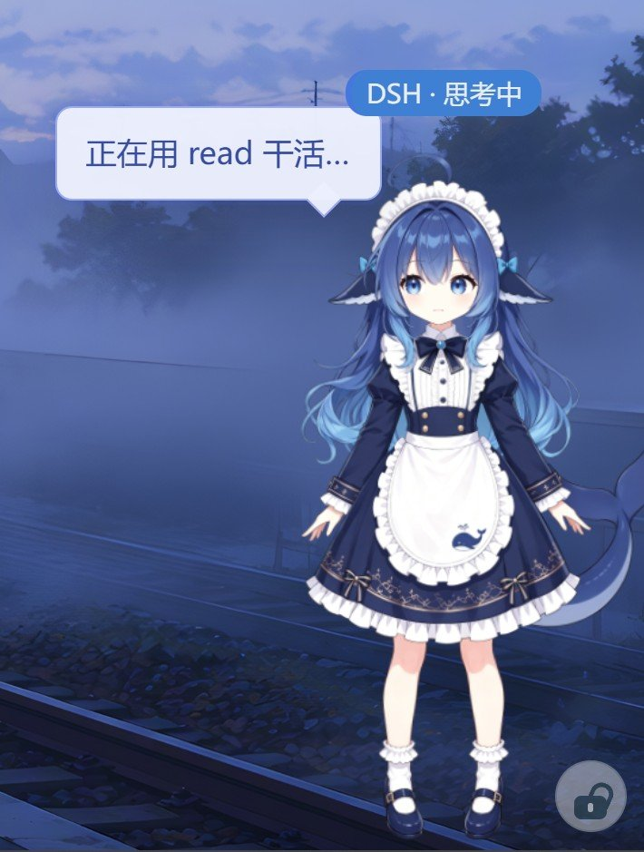
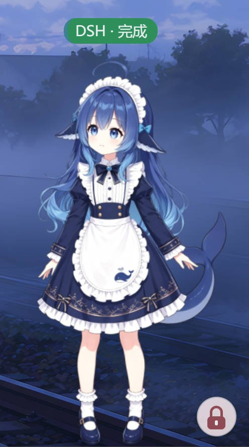
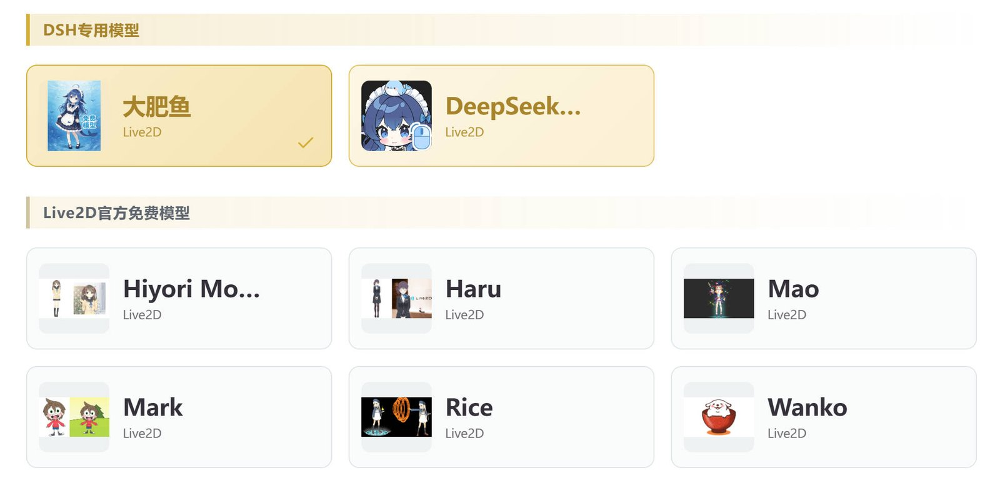
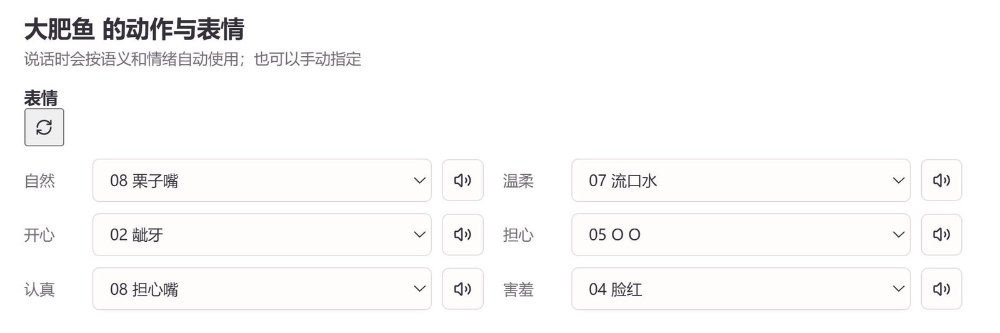

<div align="center">



# Mao-pet · DSH 专用 Live2D 桌宠

**把 DeepSeek Harness 的工作状态，变成一只住在你桌面上的 Live2D 看板娘。**

她不是贴图，是**会呼吸、会看你、会跟着 DSH 干活动起来**的桌宠。

[](#)
[](#)
[](#)
[](#)
[](#)

</div>

---



> 右下角就是她。你在 DSH 里敲需求，她在旁边 `思考中 → 执行工具 → 完成`，
> 头顶徽标实时告诉你「DSH 现在在干嘛」。

---

## ✨ 核心亮点

| | 能力 | 说明 |
|---|---|---|
| 🎭 | **真 · Live2D** | PixiJS + Cubism 4 骨骼动画，不是 GIF/序列帧。待机呼吸、眨眼、视线跟随、动作表情全部实时驱动 |
| 🐳 | **8 款内置形象** | DSH 专用（**大肥鱼**、**DeepSeek娘**）+ Live2D 官方免费 6 款，开箱即用；也支持导入自己的模型 |
| 🎨 | **自定义动作与表情** | 每个模型可逐槽位绑定动作/表情（思考、观察、聆听、开心、害羞…），DSH 的工作状态会真实驱动它们 |
| 👀 | **视线跟随鼠标** | 她的眼睛一直跟着你的光标走，转头、侧目都是真的骨骼动画 |
| 📡 | **DSH 工作状态实时显示** | **12 态**语义总线：规划 / 思考中 / 执行工具 / 回复中 / 聆听中 / 说话中 / 待确认 / 完成 / 出错 / 暂停 / 待机 / 在线 |
| 💬 | **工具状态气泡** | 「正在用 `read` 干活…」——她亲口告诉你 DSH 正在调什么工具 |
| 📜 | **流式横条** | DSH 的回答逐字铺在一条可拖动、可拉伸、可换肤的横条上，**单行滚动 / 多行可翻历史** |
| 🖱️ | **拖动交互反馈** | 拖拽带**惯性滑行**、按压有 Q 弹 + 音效，还能锁定位置、Shift 防误拖 |
| 🔊 | **8 类事件音效** | 按压 / 松开 / Agent 交接 / 任务结束 / 提问 / 授权 / 异常，内置小黄鸭、Minecraft 经验球等原版音效 |
| 🎚️ | **不透明度可调** | 10%~100% 任意调，摸鱼时让她淡一点 |

---

## 📸 功能展示

### 1️⃣ DSH 工作状态实时显示

她在 DSH 里干活时，桌宠头顶会实时显示当前阶段——**这是同类桌宠里最细的粒度**（多数只有「思考/工作」两态）。

<table>
<tr>
<td width="50%"></td>
<td width="50%"></td>
</tr>
<tr>
<td align="center"><b>执行工具中</b><br />徽标「DSH · 思考中」+ 气泡「正在用 <code>read</code> 干活…」</td>
<td align="center"><b>完成</b><br />徽标变绿「DSH · 完成」，一轮干完</td>
</tr>
</table>

**完整 12 态**（徽标颜色可在 DSH 面板逐项自定义）：

| 阶段 | 含义 | 桌宠表现 |
|---|---|---|
| `planning` | 规划 | 思考动画 + 徽标 |
| `thinking` | 思考中 | 思考动画 + 徽标 |
| `executing_tool` | 执行工具 | 观察动作 + 徽标 |
| `streaming` | 回复中 | 回应动画 + 横条逐字输出 |
| `waiting_input` | 聆听中 | 聆听动作 + 徽标 |
| `voice` | 说话中 | 说话口型（预留态） |
| `awaiting_approval` | 待确认 | 回应动作 + 徽标 |
| `complete` / `error` / `paused` / `idle` / `heartbeat` | 完成 / 出错 / 暂停 / 待机 / 在线 | 待机动画，无徽标 |

### 2️⃣ Live2D 形象与自定义



- **DSH 专用模型**（金色标识）：大肥鱼、DeepSeek娘 —— 为这个项目定制的形象
- **Live2D 官方免费模型**：Hiyori / Haru / Mao / Mark / Rice / Wanko
- 点卡片即切换形象，**写穿服务端持久化**（重启、轮询都不会弹回）
- 支持**导入自己的 Live2D 模型目录**

### 3️⃣ 自定义动作与表情



每个模型可独立配置 **6 类情绪 × 动作/表情**：

- **表情槽位**：自然 / 开心 / 认真 / 温柔 / 担心 / 害羞 → 任选模型自带表情
- **动作槽位**：思考 / 观察 / 聆听 / 说话 / 触碰 / 待机 → 任选模型自带动作
- 绑好后，**DSH 的工作状态会真实驱动它们**：`executing_tool` 播放你配的「观察动作」、`waiting_input` 播放「聆听动作」
- 每个槽位带试听按钮，点一下就知道效果

### 4️⃣ 拖动交互与反馈

| 交互 | 效果 |
|---|---|
| **拖动** | 跟手移动，松手后按速度**惯性滑行**、阻尼停稳 |
| **按压** | 角色 Q 弹一下 + 按压音效（小黄鸭） |
| **松开** | 回落音效，构成「咔哒」手感 |
| **锁定位置** | 拖不动，但点击互动照常（防误碰） |
| **SHIFT 拖动** | 必须按住 Shift 才拖得动（防误拖） |
| **不透明度** | 10%~100%，右键菜单实时调 |
| **视线跟随** | 眼睛一直跟着鼠标 |

### 5️⃣ 流式横条

DSH 的回答不走气泡，走一条**独立的横条**：

- 逐 token 铺开，**按上游原始节奏**（不是整段弹出）
- 文字按宽度**自动换行往下递增**，超出可见行数后**右侧竖条可滚动**看历史，最新始终在最底
- 可**左右拉伸**（无限长）、可拖动、可换肤（8 款）、可关闭
- 内置代码着色（`` `path/to/file` ``）、Markdown 粗体与标题

---

## 🚀 快速上手

### 环境要求

- Windows 10 / 11 x64
- **PowerShell 7**（`pwsh`，不是系统自带的 `powershell`）
- Python 3.10+
- Node.js 18+
- **DeepSeek Harness（DSH）** —— 桌宠是给它做「脸」的，没有 DSH 就只能看形象

### 安装

```powershell
# 1. 克隆
git clone <本仓库地址> Mao-dsh-pet
cd Mao-dsh-pet

# 2. 装依赖（Python venv + Node + Electron，交互式）
pwsh -NoProfile -ExecutionPolicy Bypass -File 安装依赖.ps1
```

### 配置 DSH 接入

复制模板、改一下自己的路径即可：

```powershell
Copy-Item 私人AI日记系统\dsh_config.example.json 私人AI日记系统\dsh_config.json
```

编辑 `dsh_config.json`：

```jsonc
{
  "enabled": true,
  "sessions_root": "C:\\Users\\<你的用户名>\\.dsh\\sessions",
  "workspace": "",          // 留空 = 跟随本项目目录
  "session_id": "",         // 留空 = 自动选活跃会话
  "node_path": ""           // 留空 = 自动探测 node
}
```

> 💡 `dsh_config.json` 含本机路径，**已 gitignore 不入库**。不配这个文件，DSH 会显示「未启用」。

### 启动

```powershell
# 一键启动（后端 + 桌宠）
pwsh -NoProfile -ExecutionPolicy Bypass -File start_mio.ps1

# 或一键重启（改了代码之后用；改了 Electron 外壳要加 -ForcePet）
pwsh -NoProfile -ExecutionPolicy Bypass -File restart_mio.ps1 -ForcePet
```

启动后：

1. 桌宠出现在桌面（默认右下角）
2. **右键桌宠** → 「打开 Mio」→ 进管理窗
3. 左侧导航 **「DSH」** → 看实时状态面板
4. 去 DSH 里发一条需求 → 桌宠立刻开始「思考中 → 执行工具 → 完成」

### 安装插件（可选，推荐）

没有插件时，桌宠通过**日志边车**读 DSH 会话日志（有 1~2 秒延迟）；
装上插件后，走**实时事件流**（即时、更细的功能状态）。

```powershell
dsh plugin --profile desktop add link:C:\Users\xiao1\Mao-dsh-pet\packages/dsh-live2d-mao
```

> 插件跑在 DSH 进程内，推送时**复用 DSH 的身份**——桌宠上只会看到一个 `DSH`，不会多出第二个名字。

---

## 🖱️ 右键菜单速查

| 菜单项 | 作用 |
|---|---|
| 打开/关闭对话窗口 | 桌宠自己的对话横条（走 `/api/companion/chat`） |
| 更换形象 | 打开形象图库，点卡片即切换 |
| 调整大小 | 弹滑块面板，实时缩放 |
| **调整不透明度** | 弹滑块面板，10%~100% 实时变透明 |
| 隐藏/显示说话气泡 | 工具状态气泡的独立开关 |
| 隐藏/显示流式提示 | **流式横条**的独立开关 |
| 隐藏/显示状态徽标 | 头顶徽标开关 |
| 打开 Mio | 打开管理窗 |
| 关闭桌宠 | 退出 |

> 三条通路（说话气泡 / 流式横条 / 状态徽标）**相互独立**，各自开关互不影响。

---

## 🎛️ 设置页速查

管理窗 → 「设置」：

| Tab | 内容 |
|---|---|
| **资料** | 头像、名称 |
| **桌宠** | 大小/缩放/垂直偏移、跟随鼠标、置顶、穿透、气泡开关、**交互打磨**（锁定位置 / SHIFT 拖动 / 拖拽惯性）、模型自动更换 |
| **语音** | 语音相关（当前 DSH 无 TTS，为预留） |
| **主题** | **横条**（默认宽度 / 显示行数 / 8 款皮肤）+ **气泡与互动**（气泡皮肤 / 点击序列 / 图片素材库 / 8 类音效） |

> 音效可在「主题 → 音效事件」里逐行选择：默认音效 / 内置合成音 / 内置片段（小黄鸭、Minecraft 经验球…）/ 自己上传的片段，**选中即可试听**。

---

## 🏗️ 技术架构（一句话版）

```
DSH 会话事件 ──┬─→ 日志边车（读会话日志，兜底路径）
              └─→ mao-pet 插件（DSH 进程内，实时路径）
                        ↓
              12 态状态总线（FastAPI）
                        ↓
        WebSocket ─→ Electron 桌宠窗口（Live2D 渲染）
```

- **桌宠无状态**：它只认总线上的标准 phase，不认识 DSH
- **三条独立通路**：`agent_phase`（动画/徽标）/ `agent_stream`（流式横条）/ `agent_bubble`（工具状态气泡）
- **插件只推事件**：插件跑在 `ELECTRON_RUN_AS_NODE=1` 子进程里，没有窗口能力，只负责"把 DSH 在干什么"推出去

详细设计见 [`SRC-MAP-源码地图.md`](SRC-MAP-源码地图.md) 与 [`AGENTS.md`](AGENTS.md)。

---

## 📚 文档导航

| 文档 | 用途 |
|---|---|
| [`AGENTS.md`](AGENTS.md) | ★ 工程纪律权威：三条架构红线（机器守卫）/ 变更纪律 / D1~D5 裁决 / 提交前门禁 |
| [`SRC-MAP-源码地图.md`](SRC-MAP-源码地图.md) | ★ 改哪块看哪份：界面导航 / 后端导航 / 修改守则 |
| [`docs/后续开发方向.md`](docs/后续开发方向.md) | 待办清单、明确不做的事、已知技术债 |
| [`docs/竞品对标-dsh-pet-indesktop.md`](docs/竞品对标-dsh-pet-indesktop.md) | 与 dsh-pet-indesktop / whale 的能力对比 |
| [`docs/DSH专用化阉割记录.md`](docs/DSH专用化阉割记录.md) | 项目演进记录（做了什么、为什么、怎么验） |

---

## ❓ 常见问题

<details>
<summary><b>桌宠没出现 / 起来又秒退</b></summary>

按这三条依次排查（都是踩过的真实坑）：

1. **环境变量 `ELECTRON_RUN_AS_NODE=1`** —— 从某些宿主环境启动会继承它，让 electron 退化成 node 模式。`start_mio.ps1` / `restart_mio.ps1` 已自动清理。
2. **`pet-data/pet-instance` 目录不可写** —— Chromium 单实例锁创建失败。脚本已自动回落到 Mao 主仓库的 pet-instance。
3. **Electron 工作目录错了** —— 会加载到别的仓库的 `main.js`。脚本已固定指向本仓库。

用 `restart_mio.ps1 -ForcePet` 重启最稳。详见 `docs/DSH专用化阉割记录.md` §7.4。
</details>

<details>
<summary><b>DSH 面板显示「未启用」/「离线」</b></summary>

- 「未启用」→ 缺 `私人AI日记系统/dsh_config.json`，照上文「配置 DSH 接入」建一个
- 「离线」→ DSH 没在跑，或 `sessions_root` 路径不对
</details>

<details>
<summary><b>改了代码不生效</b></summary>

- 改 `dist/core-inject` / `kernel` / `plugins` / `live2d-pet`（**手写层**）：直接改 + **升对应 `?v=` 版本号** + 刷新窗口
- 改 `澪Agent应用/src`（Vue 源码）：`npm run build:dist` 重建
- 改 `live2d-desktop/main.js`（Electron 外壳）：必须 `restart_mio.ps1 -ForcePet` 整个重启
- 管理窗里的用户偏好**不存 localStorage**（每次打开会清），一律存后端 settings
</details>

<details>
<summary><b>桌宠挡住了别的窗口怎么办</b></summary>

右键 → 「调整不透明度」调低，或「隐藏状态徽标」。鼠标穿透是自动的：**只有落在模型/横条上才可交互，其余区域直接穿透**。
</details>

---

## 📄 许可

代码 MIT。Live2D 模型素材版权归各自作者，DSH 专用模型（大肥鱼 / DeepSeek娘）随本项目分发。
内置音效片段来源见 [`docs/后续开发方向.md`](docs/后续开发方向.md) 技术债一节。

---

<div align="center">

**Mao-pet** · 为 DeepSeek Harness 而生的 Live2D 桌宠

</div>
